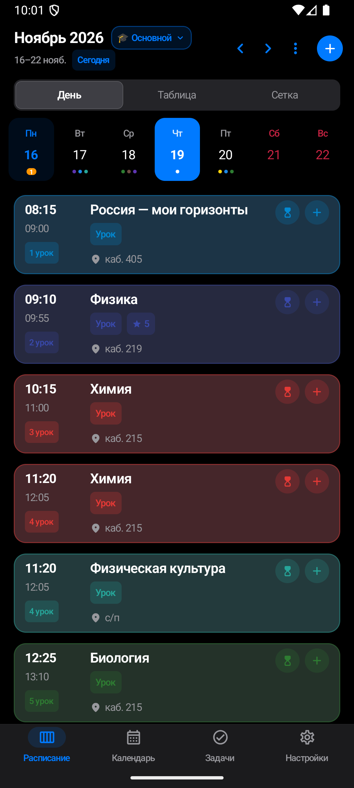
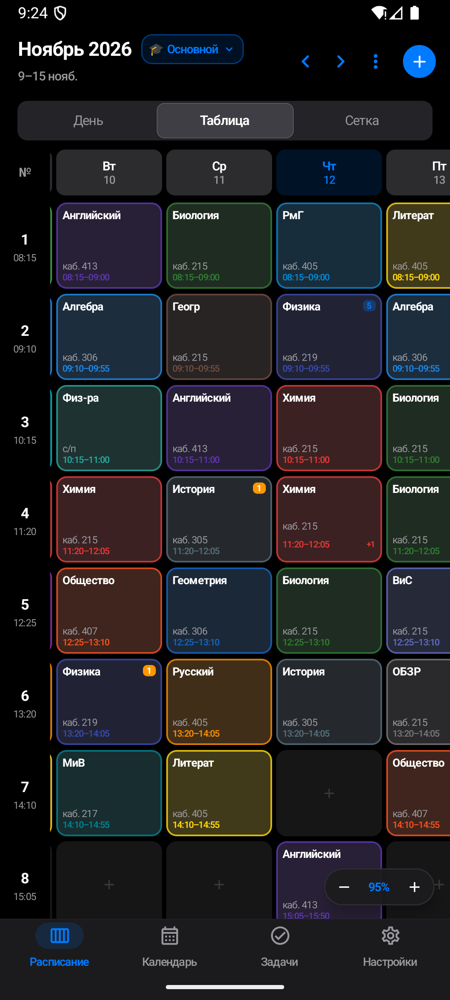
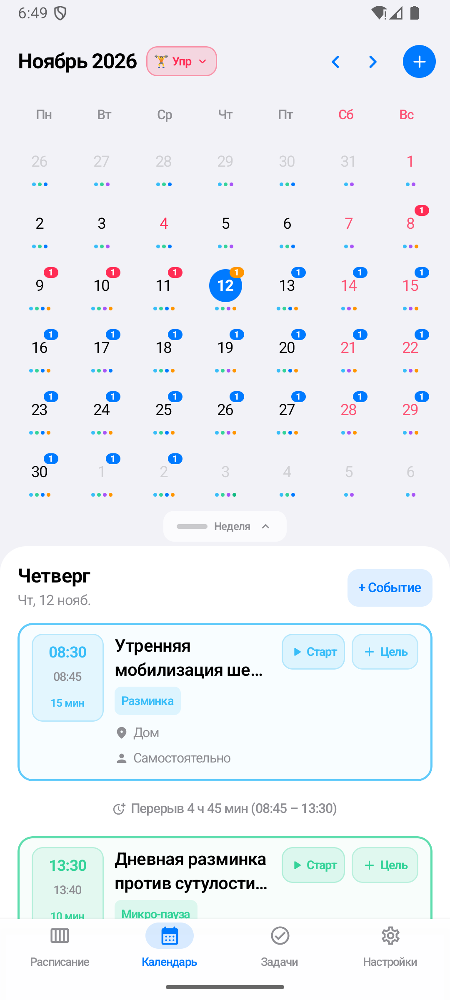
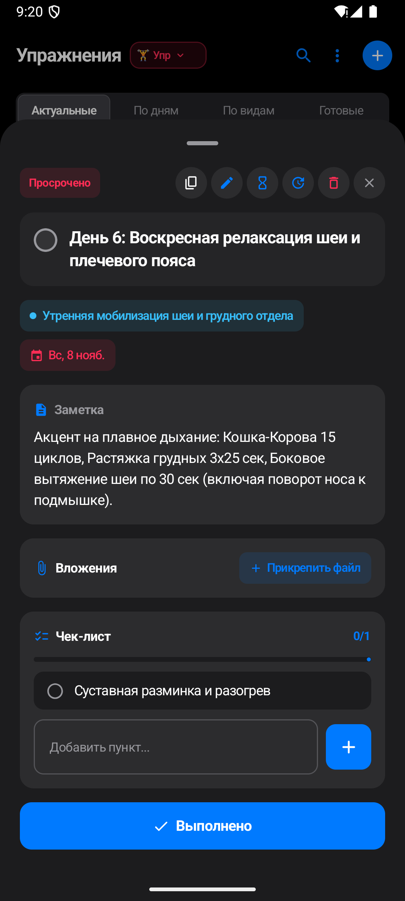

<div align="center">


# WeekFlow

**Офлайн-расписание, умные задачи, календарь событий и фокус-таймер для Android**  
*Offline-first timetable, smart homework & task manager, repeating calendar, and workout/focus planner built with Jetpack Compose.*

[](https://github.com/arch-revan-dev/WeekFlow/releases/latest)
[-34C759?style=for-the-badge&logo=android&logoColor=white)](https://github.com/arch-revan-dev/WeekFlow/releases)
[](https://kotlinlang.org/)
[](LICENSE)
[](#-приватность-и-офлайн)

<br/>

### [⬇️ Скачать готовый APK (GitHub Releases)](https://github.com/arch-revan-dev/WeekFlow/releases/latest)

</div>

---

## 📱 Зачем нужен WeekFlow

Большинство планировщиков делятся на два лагеря: либо простое школьное/вузовское расписание без нормальных задач, либо сложный таск-менеджер без понимания пар, перемен и циклов недель.

**WeekFlow** объединяет наглядную сетку расписания в духе **Weeklie**, гибкий задачник с чек-листами и приоритетами в духе **TickTick** и календарь повторяющихся событий — в одном быстром нативном Android-приложении на **Jetpack Compose** и **Room**.

> **English TL;DR:** WeekFlow is a privacy-respecting, completely offline Android planner combining a customizable weekly timetable (Day / Table / Grid views, biweekly cycle, preset profiles, grades per subject), a TickTick-inspired task & homework manager (auto-linking to the next class date, checklists, attachments with in-app viewer & clipboard copy, quick actions), a recurring calendar, focus/workout timers, custom-interval reminders, and Jetpack Glance home-screen widgets.

---

## ⬇️ Установка без Google Play

1. Перейдите в раздел [**Releases**](https://github.com/arch-revan-dev/WeekFlow/releases/latest) и скачайте **`WeekFlow-v*-release.apk`** (или `debug.apk`).
2. Откройте файл на Android-устройстве и разрешите установку из этого источника при первом запуске.

### 🔄 Автообновления через Obtainium
Если вы используете open-source менеджер обновлений **[Obtainium](https://github.com/ImranR98/Obtainium)**:
1. Нажмите **Добавить приложение** → вставьте URL репозитория:  
   `https://github.com/arch-revan-dev/WeekFlow`
2. Obtainium сам будет отслеживать новые теги в GitHub Releases и предлагать обновление в один тап.

---

## 📸 Скриншоты

| Расписание (День + оценки) | Таблица недели (Zoom) | Календарь (Светлая тема) | Карточка задачи и чек-лист |
| :---: | :---: | :---: | :---: |
|  |  |  |  |

---

## ✨ Ключевые возможности

### 📅 Расписание и Календарь
- **3 режима просмотра в Расписании и Календаре**:
  - **День** — карточки занятий с длительностью, аудиторией, преподавателем, динамическими переменами и живым прогрессом текущего урока.
  - **Таблица** — масштабируемая матрица всей недели с предметами и параллельными событиями в одном компактном виде.
  - **Сетка** — наглядная временная шкала с позиционированием по часам и параллельными слотами.
- **Быстрый возврат к «Сегодня»** — удобная кнопка перехода к текущей дате в обоих разделах.
- **Пресеты расписания** — отдельные профили под учёбу (семестры, числитель/знаменатель), работу или тренировки с автопереключением по датам и импортом/экспортом в JSON.
- **Повторяющиеся события и расписания** — гибкая настройка регулярных событий по дням недели (например, «учёба Пн–Пт 08:00–16:00»).
- **Оценки по предметам** — выставление оценок на предмет с привязкой к неделям.
- **4 стиля карточек + кастомизация**: `Обводка`, `Полоса`, `Заливка`, `Минимал`, выбор плотности сетки, скругления углов, светлая и тёмная темы.

### ✅ Умный задачник и Вложения
- **Привязка к расписанию** — домашнее задание или задача легко привязывается к предмету и ближайшему занятию.
- **Гибкая структура** — приоритеты, чек-листы с прогрессом, заметки, фильтры (*Актуальные / По дням / По предметам / Готовые*) и быстрый ввод.
- **Меню быстрых действий по долгому нажатию** — копирование, фокус-таймер, перенос на следующее занятие и удаление без лишних нажатий.
- **Встроенный просмотр фото и копирование в буфер обмена** — прикреплённые изображения открываются мгновенно во встроенном lightbox-просмотрщике с кнопкой копирования картинки прямо в карточке задачи.

### ⏱ Таймеры, Тренировки и Уведомления
- **Таймер фокуса и режим тренировок** — поддержка подходов и интервалов отдыха для спортивных/учебных пресетов.
- **Регулярные напоминания с гибким интервалом** — барабан выбора любого интервала (меньше 15 минут, минуты и часы) или точного фиксированного времени, по дням недели и активному окну часов.
- **Точные системные уведомления** — срабатывание до начала пары/события через `AlarmManager` + утренние и вечерние сводки.

### 📲 Виджеты рабочего стола
- **Два виджета на Jetpack Glance** — быстрый просмотр ближайших занятий и актуальных задач на сегодня прямо с домашнего экрана с кнопкой принудительного обновления.

---

## 🔒 Приватность и офлайн

- **Нет разрешения `INTERNET`** — приложение физически не отправляет данные в сеть (см. [`AndroidManifest.xml`](app/src/main/AndroidManifest.xml)).
- **Никаких закрытых SDK и трекеров** — в проекте нет Firebase, Google Analytics, Crashlytics и рекламных библиотек. Все зависимости описаны в [`gradle/libs.versions.toml`](gradle/libs.versions.toml).
- Ваши данные хранятся локально в базе Room SQLite на устройстве и полностью под вашим контролем (доступен экспорт/импорт пресетов).

---

## 🛠 Технологический стек

| Слой | Технологии |
| :--- | :--- |
| **Язык** | Kotlin `2.1.0`, Coroutines & Flow |
| **UI** | Jetpack Compose (`BOM 2026.03.01`), Material 3, Custom HIG Design Tokens |
| **Навигация** | Jetpack Navigation 3 (`navigation3-ui`, `navigation3-runtime`) |
| **Хранение данных** | Room `2.7` (SQLite), DataStore Preferences, Kotlinx Serialization JSON |
| **DI** | Koin `4.0.0` |
| **Виджеты и фон** | Jetpack Glance `1.1.1`, `AlarmManager`, `BootCompletedReceiver` |
| **Сборка** | Android Gradle Plugin `9.0.1`, KSP, JVM `17`, `minSdk 26`, `targetSdk 36` |

---

## 🚀 Сборка из исходников

Для сборки понадобится **JDK 17** и актуальный **Android SDK (API 36)**:

```bash
git clone https://github.com/arch-revan-dev/WeekFlow.git
cd WeekFlow

# Запуск всех JVM unit-тестов
./gradlew testDebugUnitTest

# Сборка Debug APK
./gradlew assembleDebug

# Сборка Release APK
./gradlew assembleRelease
```

---

## 💛 Поддержка проекта и выход в магазины

**WeekFlow** полностью бесплатен и открыт под свободной лицензией.

Сейчас у проекта пока нет официальных публикаций в магазинах приложений из-за платных аккаунтов разработчика (**\$25** разово за **Google Play** и **\$99/год** за **Apple App Store**). Если приложение оказалось вам полезным, поддержать проект можно уже сейчас:

- Поставьте ⭐ **Star** репозиторию — это помогает другим пользователям находить WeekFlow.
- Делитесь баг-репортами и идеями в [**Issues**](https://github.com/arch-revan-dev/WeekFlow/issues).
- Для публикации нового личного аккаунта в Google Play требуется закрытый тест минимум с **12 тестировщиками в течение 14 дней подряд** — если вы готовы поучаствовать в тестировании перед выходом в Play Market, следите за обновлениями в **Releases** / **Issues**.

---

## 📄 Лицензия и права на бренд

Исходный код **WeekFlow** распространяется по лицензии **[Apache License 2.0](LICENSE)**.

**Важно о названии и иконках (см. [`NOTICE`](NOTICE)):**
- Свободная лицензия Apache 2.0 распространяется **только на исходный код** (раздел 6 лицензии не передаёт права на товарные знаки и фирменный стиль).
- Название **WeekFlow**, логотип и иконки приложения остаются за оригинальным автором (`arch-revan-dev`). При публикации форков или собственных сборок в магазинах приложений необходимо использовать собственное название, `applicationId` и иконку.
